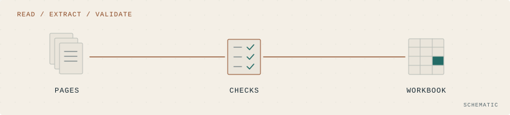

<!-- Generated by scripts/build.py. Edit profile.json, templates/, or scripts/art.py. -->

# Yohannes Melese

**AI/ML Engineer · Software · Electronics**  
Addis Ababa, Ethiopia

### I build intelligence into working systems.

[Portfolio ↗](<https://yohannesmelese.com>) · [Selected work ↓](#01--selected-systems) · [Contact ↗](<mailto:yohannesmelese4@gmail.com>)

<picture>
  <source media="(max-width: 600px) and (prefers-color-scheme: dark)" srcset="assets/hero-dark-compact.svg">
  <source media="(max-width: 600px) and (prefers-color-scheme: light)" srcset="assets/hero-light-compact.svg">
  <source media="(prefers-color-scheme: dark)" srcset="assets/hero-dark.svg">
  <source media="(prefers-color-scheme: light)" srcset="assets/hero-light.svg">
  
</picture>

I'm an AI/ML engineer with a foundation in electronics, computer science, and competitive programming. My work connects research with the less glamorous details that make a system useful: evaluation, validation, reproducibility, and delivery.

I like problems where the model is only part of the answer. A document pipeline needs an audit trail. A language model needs an honest evaluation. A hardware implementation needs to respect the device it runs on.

## 01 / Selected systems

### Documents → decisions you can inspect

<picture>
  <source media="(max-width: 600px) and (prefers-color-scheme: dark)" srcset="assets/documents-dark-compact.svg">
  <source media="(max-width: 600px) and (prefers-color-scheme: light)" srcset="assets/documents-light-compact.svg">
  <source media="(prefers-color-scheme: dark)" srcset="assets/documents-dark.svg">
  <source media="(prefers-color-scheme: light)" srcset="assets/documents-light.svg">
  
</picture>

**Tax Document Extraction Pipeline**

Tax returns arrive as inconsistent PDFs, scans, and supporting statements. I built a pipeline that combines OCR and deterministic extraction with an LLM fallback, then checks arithmetic identities before writing a workbook. Confidence-based review and a JSON audit trail keep the output inspectable.

`Python · OCR · Pydantic · PySide6`

[Read the case study ↗](<https://yohannesmelese.com/projects/tax-document-ocr>)

### Parallel models. A hardware constraint.

<picture>
  <source media="(max-width: 600px) and (prefers-color-scheme: dark)" srcset="assets/fpga-dark-compact.svg">
  <source media="(max-width: 600px) and (prefers-color-scheme: light)" srcset="assets/fpga-light-compact.svg">
  <source media="(prefers-color-scheme: dark)" srcset="assets/fpga-dark.svg">
  <source media="(prefers-color-scheme: light)" srcset="assets/fpga-light.svg">
  
</picture>

**FPGA-Based Ensemble Neural Networks**

My master's research explored an ensemble of lightweight neural networks on FPGA hardware. I combined parallel execution, quantization, and a voting stage to investigate real-time inference. It brought model design and hardware implementation into the same engineering problem.

`Verilog · FPGA · TensorFlow · Python`

[Read the case study ↗](<https://yohannesmelese.com/projects/fpga-ensemble-networks>)

### A competition workflow, made scriptable

<picture>
  <source media="(max-width: 600px) and (prefers-color-scheme: dark)" srcset="assets/cli-dark-compact.svg">
  <source media="(max-width: 600px) and (prefers-color-scheme: light)" srcset="assets/cli-light-compact.svg">
  <source media="(prefers-color-scheme: dark)" srcset="assets/cli-dark.svg">
  <source media="(prefers-color-scheme: light)" srcset="assets/cli-light.svg">
  
</picture>

**Zindi CLI**

Moving between a competition page, datasets, submissions, and results interrupts an otherwise reproducible workflow. I built a Python CLI that connects those steps, with structured JSON output and typed failures for scripts and agents. The implementation is public, so you can inspect the engineering directly.

`Python · Typer · Requests · pytest`

[Explore the code ↗](<https://github.com/JONNY-ME/zindi-cli>) · [Read the case study ↗](<https://yohannesmelese.com/projects/zindi-cli>)

## 02 / Research bench

Ongoing research and experiments — questions I'm working through.

**[African-language speech recognition](<https://yohannesmelese.com/projects/african-language-asr>)**  
Combining recognizers for Lingala, Shona, and Luganda, with speaker-aware evaluation and language routing that cannot rely on hidden labels.

**[Multilingual health QA](<https://github.com/JONNY-ME/multilingual-health-qa>)**  
Comparing baselines and LoRA adaptation for health questions in low-resource African languages, with language-specific evaluation.

**[Historical handwriting recognition](<https://yohannesmelese.com/projects/historical-handwriting-recognition>)**  
Adapting visual readers for seventeenth-century archives, preserving transcript provenance, replayable experiments, and negative findings.

## 03 / Engineering foundations

**Toptal Verified Expert in Engineering.** AI/ML engineering and development for clients; previously led robotics and autonomous-systems R&D at Ethronics.

**M.Sc. Electronics Engineering, ASTU.** 4.00/4.00, University Topper. Dual-major B.Sc. in Electronics & Communication Engineering and Computer Science & Engineering; 3.98/4.00, Gold Medalist.

**Competitive programming → engineering discipline.** First place, Zindi UmojaHack Ethiopia (2021); EtCPC silver (2022) and bronze (2020).

More background & the complete project index

Before these projects, I worked on Python development and training data at Turing, supported electronics research and laboratories at ASTU, and led data-science tutorials and programming contests at CSEC-ASTU. Teaching and team leadership remain part of how I work.

[All projects](<https://yohannesmelese.com/projects>) · [Research](<https://yohannesmelese.com/research>) · [About & experience](<https://yohannesmelese.com/about>) · [Competition portfolio](<https://zindi.africa/users/J0NNY/competitions/portfolio>)

## 04 / Workbench log

Latest public changes from three selected repositories. Commit dates describe the work; this is a daily snapshot, not a live status indicator.

<!-- activity:start -->
Public repository updates will appear after the first successful refresh.
<!-- activity:end -->

## 05 / Start a conversation

Working on an AI system, document automation, or hardware-aware ML? I'd be glad to hear about the problem, its constraints, and what a useful outcome would look like.

[Email me ↗](<mailto:yohannesmelese4@gmail.com>) · [Portfolio](<https://yohannesmelese.com>) · [LinkedIn](<https://www.linkedin.com/in/yohannes-melese/>) · [Toptal](<https://www.toptal.com/developers/resume/yohannes-melese>)

---

The Signal Foundry · Original diagrams, real projects. [How this profile is built](docs/MAINTAINING.md).
