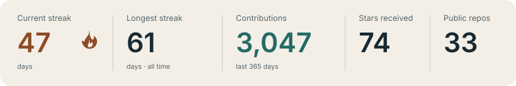
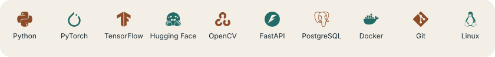
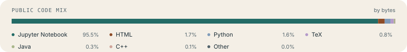
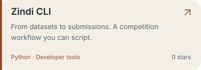
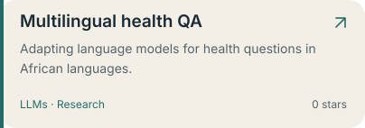
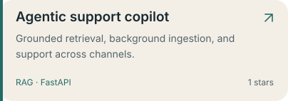
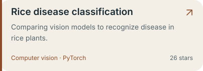

<!-- Generated by scripts/build.py. Edit profile.json, templates/, or scripts/art.py. -->

<picture>
  <source media="(max-width: 600px) and (prefers-reduced-motion: reduce) and (prefers-color-scheme: dark)" srcset="assets/hero-static-dark-compact.svg">
  <source media="(max-width: 600px) and (prefers-reduced-motion: reduce) and (prefers-color-scheme: light)" srcset="assets/hero-static-light-compact.svg">
  <source media="(prefers-reduced-motion: reduce) and (prefers-color-scheme: dark)" srcset="assets/hero-static-dark.svg">
  <source media="(prefers-reduced-motion: reduce) and (prefers-color-scheme: light)" srcset="assets/hero-static-light.svg">
  <source media="(max-width: 600px) and (prefers-color-scheme: dark)" srcset="assets/hero-dark-compact.svg">
  <source media="(max-width: 600px) and (prefers-color-scheme: light)" srcset="assets/hero-light-compact.svg">
  <source media="(prefers-color-scheme: dark)" srcset="assets/hero-dark.svg">
  <source media="(prefers-color-scheme: light)" srcset="assets/hero-light.svg">
  
</picture>

I'm Yohannes Melese — Jonny here. I build machine learning systems, useful Python tools, and occasionally the hardware underneath. Based in Addis Ababa.

[Portfolio ↗](<https://yohannesmelese.com>) &nbsp; / &nbsp; [Email ↗](<mailto:yohannesmelese4@gmail.com>) &nbsp; / &nbsp; [LinkedIn ↗](<https://www.linkedin.com/in/yohannes-melese/>) &nbsp; / &nbsp; [Toptal ↗](<https://www.toptal.com/developers/resume/yohannes-melese>)

<picture>
  <source media="(max-width: 600px) and (prefers-color-scheme: dark)" srcset="assets/stats-dark-compact.svg">
  <source media="(max-width: 600px) and (prefers-color-scheme: light)" srcset="assets/stats-light-compact.svg">
  <source media="(prefers-color-scheme: dark)" srcset="assets/stats-dark.svg">
  <source media="(prefers-color-scheme: light)" srcset="assets/stats-light.svg">
  
</picture>

### Tools I work with

<picture>
  <source media="(max-width: 600px) and (prefers-color-scheme: dark)" srcset="assets/tools-dark-compact.svg">
  <source media="(max-width: 600px) and (prefers-color-scheme: light)" srcset="assets/tools-light-compact.svg">
  <source media="(prefers-color-scheme: dark)" srcset="assets/tools-dark.svg">
  <source media="(prefers-color-scheme: light)" srcset="assets/tools-light.svg">
  
</picture>

<picture>
  <source media="(max-width: 600px) and (prefers-color-scheme: dark)" srcset="assets/languages-dark-compact.svg">
  <source media="(max-width: 600px) and (prefers-color-scheme: light)" srcset="assets/languages-light-compact.svg">
  <source media="(prefers-color-scheme: dark)" srcset="assets/languages-dark.svg">
  <source media="(prefers-color-scheme: light)" srcset="assets/languages-light.svg">
  
</picture>

## Selected repositories

<a href="https://github.com/JONNY-ME/zindi-cli"><picture>
  <source media="(max-width: 600px) and (prefers-color-scheme: dark)" srcset="assets/repo-zindi-dark-compact.svg">
  <source media="(max-width: 600px) and (prefers-color-scheme: light)" srcset="assets/repo-zindi-light-compact.svg">
  <source media="(prefers-color-scheme: dark)" srcset="assets/repo-zindi-dark.svg">
  <source media="(prefers-color-scheme: light)" srcset="assets/repo-zindi-light.svg">
  
</picture></a>
<a href="https://github.com/JONNY-ME/multilingual-health-qa"><picture>
  <source media="(max-width: 600px) and (prefers-color-scheme: dark)" srcset="assets/repo-health-dark-compact.svg">
  <source media="(max-width: 600px) and (prefers-color-scheme: light)" srcset="assets/repo-health-light-compact.svg">
  <source media="(prefers-color-scheme: dark)" srcset="assets/repo-health-dark.svg">
  <source media="(prefers-color-scheme: light)" srcset="assets/repo-health-light.svg">
  
</picture></a>
<a href="https://github.com/JONNY-ME/agentic-support-copilot"><picture>
  <source media="(max-width: 600px) and (prefers-color-scheme: dark)" srcset="assets/repo-copilot-dark-compact.svg">
  <source media="(max-width: 600px) and (prefers-color-scheme: light)" srcset="assets/repo-copilot-light-compact.svg">
  <source media="(prefers-color-scheme: dark)" srcset="assets/repo-copilot-dark.svg">
  <source media="(prefers-color-scheme: light)" srcset="assets/repo-copilot-light.svg">
  
</picture></a>
<a href="https://github.com/JONNY-ME/Microsoft-Rice-Disease-Classification-Challenge"><picture>
  <source media="(max-width: 600px) and (prefers-color-scheme: dark)" srcset="assets/repo-rice-dark-compact.svg">
  <source media="(max-width: 600px) and (prefers-color-scheme: light)" srcset="assets/repo-rice-light-compact.svg">
  <source media="(prefers-color-scheme: dark)" srcset="assets/repo-rice-dark.svg">
  <source media="(prefers-color-scheme: light)" srcset="assets/repo-rice-light.svg">
  
</picture></a>

**Beyond the repos:** [Document AI](<https://yohannesmelese.com/projects/tax-document-ocr>) · [FPGA research](<https://yohannesmelese.com/projects/fpga-ensemble-networks>) · [All projects ↗](<https://yohannesmelese.com/projects>)

**Currently exploring:** [African-language speech](<https://yohannesmelese.com/projects/african-language-asr>), [historical handwriting](<https://yohannesmelese.com/projects/historical-handwriting-recognition>), [hardware-aware ML](<https://yohannesmelese.com/projects/fpga-ensemble-networks>).

Have an interesting ML, automation, or embedded-systems problem? Let's build something useful.

[Email me ↗](<mailto:yohannesmelese4@gmail.com>) · [Portfolio](<https://yohannesmelese.com>) · [LinkedIn](<https://www.linkedin.com/in/yohannes-melese/>) · [Toptal](<https://www.toptal.com/developers/resume/yohannes-melese>)

A little more about me

**Toptal Verified Expert in Engineering.** AI/ML engineering and development for clients; previously led robotics and autonomous-systems R&D at Ethronics.

**M.Sc. Electronics Engineering, ASTU.** 4.00/4.00, University Topper. Dual-major B.Sc. in Electronics & Communication Engineering and Computer Science & Engineering; 3.98/4.00, Gold Medalist.

**Competitive programming → engineering discipline.** First place, Zindi UmojaHack Ethiopia (2021); EtCPC silver (2022) and bronze (2020).

Before these projects, I worked on Python development and training data at Turing, supported electronics research and laboratories at ASTU, and led data-science tutorials and programming contests at CSEC-ASTU. Teaching and team leadership remain part of how I work.

GitHub numbers, in plain text

As of **2026-11-21**: **45 days** current streak; **61 days** longest streak; **3,017** contributions in the last 365 days; **74** stars received; **33** public repositories.

Contribution counts match the publicly visible GitHub calendar, including anonymous counts already shared there. Streaks use consecutive contribution days; today can remain unfinished. Stars exclude forks. Languages describe repository bytes, with notebooks kept as their own category. [Data definitions and build instructions](docs/MAINTAINING.md).

